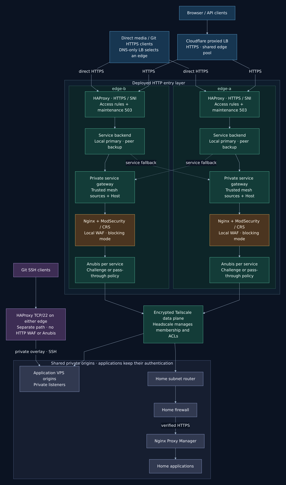
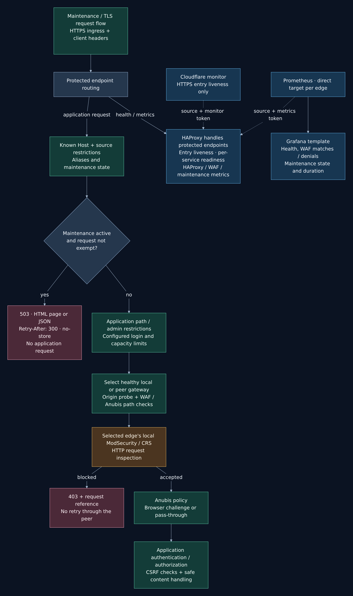
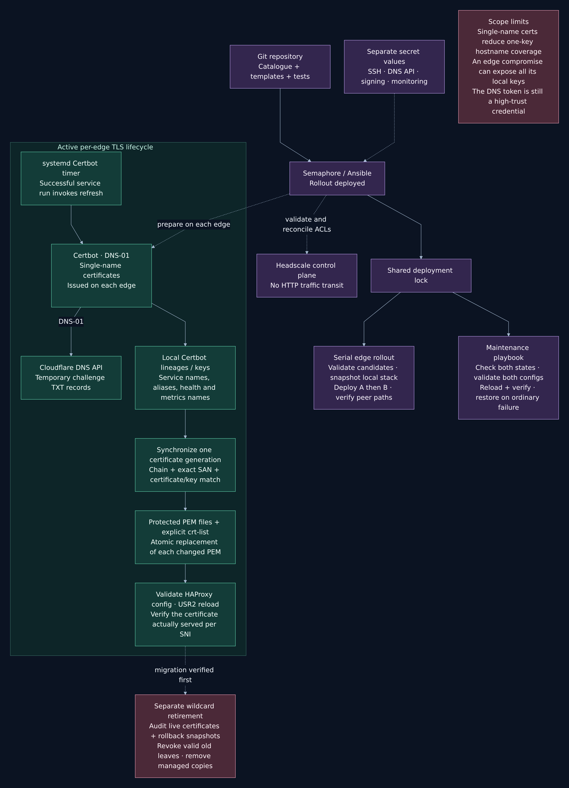

<p>The next thing my new public entrance protected me from was saving my own article. I tried to edit a post in Bludit, got blocked, and then found that editing a file and committing it through Gitea's web interface had much the same result. Both edges had something to say about it. This is a slightly awkward development when the thing you are trying to publish is an explanation of how the infrastructure works, complete with commands and configuration examples. Those examples are exactly the sort of text a generic attack detector is going to find interesting, which left me with a more useful problem than simply asking whether the WAF was switched on: how much of that text should it be allowed to ignore, and where? I wanted to be able to write about the lab without removing the checks everywhere else. Getting that distinction right became part of this follow-up, alongside maintenance controls and a change to the certificates. Apparently getting two entrances working was only enough plumbing for the first article.</p>

<p>In <a href="https://blog.interlope.xyz/load-balancing-my-homelab">Load Balancing My Homelab</a>, the work was mostly about reaching the applications and keeping an alternative route available when an edge component failed. Cloudflare chooses the public entrance, then HAProxy chooses a local or peer path for the requested service. The origins are still shared, and Nginx Proxy Manager still handles the last part of the route to applications at home. This round keeps that arrangement and adds more decisions along the way. The latest version is now deployed on both edges: the WAF has scoped editor exceptions, HAProxy can return maintenance responses, and the listeners use individual certificates instead of the wildcard. The request still crosses a WAF when it takes the other edge's private route. Generating the certificates came first; this rollout put them into HAProxy's active configuration and installed the renewal integration. I am keeping the generic names from the first post, <code>edge-a</code> and <code>edge-b</code>, and leaving the live inventory out of the examples. The diagram has also been split up so that following one request doesn't require reading the certificate-renewal workflow at the same time.</p>

> [!NOTE]- Deployment status, 11 November 2026
> Both edges now run the revised WAF exceptions, maintenance support and single-name TLS configuration. The exception tests described below ran locally with the configured CRS image. Enabling maintenance for a service and retiring the old wildcard use separate tasks; neither happens just because the normal deployment has run.

<figure>
<a href="../img/infrastructure-overview.png"></a>
<figcaption>The deployed request paths. Solid arrows carry application traffic; dashed cross-edge arrows are backup routes. Each selected HTTP path crosses the WAF on the edge that handles it.</figcaption>
</figure>

<h2>The article was the suspicious bit</h2>

<p>The placement of the WAF matters because there are several ways into an application now. Putting it only in the obvious local route would leave the peer route to be considered separately, and treating a native client as an exception to everything would undo the reason for adding request inspection in the first place. Each private service gateway therefore forwards to its own loopback WAF listener, then to its local Anubis and the origin. When edge-a chooses the gateway on edge-b, edge-b does the inspection. Headscale manages the Tailscale clients and their access policy; HTTP traffic stays on the mesh data plane rather than passing through the control server. The gateway still has only its local destination, so it cannot choose the peer again and send the request around in circles. A rejected request also has a definite end to its journey: the WAF returns a 403 with a reference. HAProxy doesn't interpret that refusal as an invitation to submit the same article to the other WAF and see whether it gets a more agreeable answer. That would be a strange sort of security policy, quite apart from the problems with replaying writes after an uncertain response.</p>

```tabs
@tab Local request
client → edge-a HTTPS → edge-a WAF → edge-a Anubis → origin

@tab Peer fallback
client → edge-a HTTPS → edge-b private gateway → edge-b WAF → edge-b Anubis → origin

@tab WAF refusal
selected WAF → 403 + reference → client
```

<p>Following the references for the failed saves brought up file-access, command-execution and HTML-related signatures, followed by rule <code>949110</code>. That last rule applies the inbound anomaly-score decision; removing it would change blocking for a lot more than my editing session. The more interesting detail was that both applications put the main text in a field called <code>content</code>. It would have been easy to give that field the same exception on both services, but the requirements diverge as soon as you think about what is being saved. A repository can contain a SQL file, a PHP program, a shell script or the JavaScript source for a security test. That is normal repository content. The blog also needs to accept technical examples and HTML, but I still want it to retain useful checks on what gets submitted. The deployed rules therefore give Bludit an exception for the ten signatures recorded for the article operation, only on POSTed <code>content</code> in the creation, editing and draft-save routes. The other XSS detectors, SQL injection rules, PHP checks and traversal checks stay active on that field. Gitea gets a broader exception across injection families, restricted to file content on its new-file, edit-file and diff-preview routes. Commit messages and repository paths remain ordinary inspected inputs, as do the other form fields, cookies and headers. Even a query-string parameter called <code>content</code> disables the exception for that request, so the shared name cannot quietly extend it to another input location.</p>

<p>There is still a cost to those decisions, and the field restrictions don't make that cost disappear. A command matching one of the excluded Bludit signatures can pass in the article body. A script submitted as the contents of a Gitea file can pass too, because storing scripts in a repository is normal. The applications have to decide who can write, check their CSRF tokens, and handle the saved data safely. The WAF doesn't establish a valid application session before applying an exception. Anubis has another job again: it may ask a browser to complete a proof-of-work challenge, while a client-compatible route can pass through to the application's authentication. Completing that challenge says nothing about whether a piece of HTML is safe to render later. That remains application work, including the output encoding and HTML sanitization described in <a href="https://cheatsheetseries.owasp.org/cheatsheets/Cross_Site_Scripting_Prevention_Cheat_Sheet.html">OWASP's XSS prevention guidance</a>. I am also leaving the CRS files themselves alone and using the <a href="https://coreruleset.org/docs/2-how-crs-works/2-3-false-positives-and-tuning/">scoped exclusion mechanisms</a>, so updating the rule set doesn't mean maintaining a private fork of its detection patterns.</p>

<p>The local tests make that compromise visible. Ordinary article HTML and command examples passed through the narrower Bludit rules, while the tested script tags, event-handler payloads, SQL/PHP injections and traversal strings still returned 403 in blocking mode. Gitea accepted the arbitrary source examples its file editor needs. Then the exception-dependent examples were sent to another route, another vhost and the query string, where they had to be blocked again. The same configured CRS image ran against disposable origins in both observation and blocking modes. Those results give me regression cases to keep, rather than a claim that the filter can recognize every malicious variation. The rollout now puts those rules in front of the real applications. Saving and autosaving an article, then editing and committing a file through Gitea, remain the checks that exercise the complete sessions rather than the disposable test origins. Other clients have their own small protocol adjustments in the configuration, such as the MIME type used by Git smart-HTTP read negotiation or text packets used by polling clients. They don't need a higher anomaly threshold for every service. The starting policy remains blocking at paranoia level 1, with an inbound threshold of 5.</p>

<p>Some operational consequences are less obvious until you look past the rule matches. There is one shared WAF process on each edge, with a separate listener per HTTP service. Losing that process affects all the local HTTP paths it protects, even though the listeners are separate; the peer can provide a healthy path, but losing both WAFs is a wider outage. Request-body inspection also has limits, so an upload can be refused there even when the general proxy upload limit would allow it. Response-body inspection is off and proxy response buffering is disabled for streaming compatibility. This is filtering incoming requests, with the applications responsible for what they eventually serve. Native APIs and direct DNS-only HTTPS clients still cross that filter. Git SSH takes its own TCP route to Gitea and is handled by the SSH server and repository permissions. The blog's Anubis policy also distinguishes public pages from administration: articles and sitemap routes can pass through for crawlers, while administration retains its source restriction and challenge before Bludit's login. Getting the article to a crawler still needs a real response check, including any separate Cloudflare challenge rules. The log output is deliberately sparse. Full ModSecurity diagnostics can include the input it matched, which is not something I want copied into container logs when that input might be a password, a token or an unpublished article. The collector keeps a fixed service label, the numeric rule ID and the reference returned to the client. That is enough to correlate the refusal with its matches, although it means reproducing the request is part of understanding a false positive. The protected WAF metrics route exposes the configured blocking state, collector snapshot time, match counts and denial counts for Prometheus. Several signatures can match one request, so those counters need to be read together; a large match count is not a count of attackers. The deployment canary also checks a normal request and a synthetic XSS request against a test resource, without submitting its test payloads to a real application. A few known requests are much easier to reason about than a green indicator that merely says the container exists.</p>

<h2>Taking an application down on purpose</h2>

<p>When I take the blog down for an upgrade, HAProxy serves the maintenance page before the request reaches the WAF, Anubis or Bludit. I can even stop Bludit and visitors still get an explanation. The deployment installs the page on both edges. A separate Semaphore job switches maintenance on and off by service name.</p>

<p>The first time I switched the blog to maintenance, Grafana showed it as active and I could still read the article. My home IP was on the admin allowlist. To check what a visitor would get from the same connection, I sent <code>X-Edge-Maintenance-Check: 1</code>. That header forces the maintenance response while the switch is on. I asked for JSON so I could see exactly what an API client would receive.</p>

```tabs
@tab JSON client
curl -si -H 'Accept: application/json' -H 'X-Edge-Maintenance-Check: 1' https://blog.interlope.xyz/

@tab HTML visitor
curl -si -H 'Accept: text/html' -H 'X-Edge-Maintenance-Check: 1' https://blog.interlope.xyz/
```

<p>Here are the headers and body I got through Cloudflare with the JSON command.</p>

```http
HTTP/2 503
content-type: application/json
content-length: 41
retry-after: 300
x-edge-maintenance: active
x-request-id: 9415a92f-25fb-4dbf-9abd-3f1fbea15dc4
cache-control: no-store
cf-cache-status: DYNAMIC

{"error":"maintenance","retry_after":300}
```

<p>Changing <code>Accept</code> to <code>text/html</code> gave me the same 503 and a page with a 🚧 sign and the word “maintenance”. The five minutes in <code>Retry-After</code> tell clients when to try again. The blog stays in maintenance until I run the Semaphore job with <code>disable</code>.</p>

<p>Having two edges makes the switch more involved than writing a file on whichever machine I happen to be connected to. The Semaphore task takes the service key from the existing catalogue and expands its domains and aliases, so there isn't another list to maintain by hand. It reads the state on both machines and refuses a disagreement, then validates both candidate configurations before asking either HAProxy to reload. It also takes the same shared lock as the normal deployment and preserves the state of other services already in maintenance. That is the part I want the automation to do reliably: make the intended change against a known starting state, without losing somebody else's maintenance setting along the way. The reloads are still separate operations on separate machines. An ordinary validation or verification failure has a restoration path, while an interrupted runner or a lost SSH connection can leave partial work and a lock to investigate. There are limits on what the response itself can accomplish too. Open streams keep running, and content already cached by Cloudflare may never reach the new rules at all. An immediate change for those responses requires handling the cache separately. When reopening a service, I still have to check that the application works; making the maintenance page disappear only demonstrates that HAProxy has stopped returning that page.</p>

<figure>
<a href="../img/request-lifecycle.png"></a>
<figcaption>The installed request handling. An enabled maintenance response ends at HAProxy, while a WAF rejection ends at the selected WAF.</figcaption>
</figure>

<p>Maintenance also needs to mean something intelligible in the graphs. The installed maintenance metrics expose an active flag and a start timestamp per service and edge. Repeating an enable action keeps the original start time; disabling and enabling again starts another interval. If an old maintenance state has no recorded date, it stays unknown rather than gaining a date invented during the next deployment. The dashboard supplied in the repository separates those values from the availability of the scrape, because a collector that has disappeared mustn't look like a service that is safely back online. Deploying HAProxy installs the metrics endpoints; adding their scrape jobs to Prometheus and importing the Grafana dashboard are separate monitoring changes. Meanwhile, the common Cloudflare monitor keeps its narrower job from the first post: check the HTTPS entrance using the dedicated Host, allowed source and monitor token. It can stay healthy while an application is stopped or deliberately in maintenance. With a shared edge pool, removing the whole entrance because one service is being upgraded would affect other services that are working normally. The <a href="https://developers.cloudflare.com/load-balancing/monitors/">monitor's verdict</a> has the scope of the endpoint I gave it, and the application probes still have to tell me what is happening behind that entrance. Prometheus continues to use a direct, verified-HTTPS target for each edge, rather than an application load-balancer name that might send both scrapes to the same selected machine.</p>

<h2>A certificate for each name</h2>

<p>The wildcard was convenient when setting up the entrances. Each hostname now has its own certificate, issued locally on each edge, and HAProxy selects it from an explicit SNI list. The certificates were generated before this deployment; the listeners now use that list rather than the old wildcard PEM. The reason for the smaller scope is fairly mundane: a copied key for one single-name certificate should only carry that certificate's hostname coverage. That doesn't protect all the other keys from somebody who owns the entire edge, and the local DNS API credential remains a particularly sensitive credential. The machine still needs the material for all the names it serves. I am reducing the reach of one certificate rather than claiming that the services have become isolated from a root compromise of their shared proxy. There is also some easily overlooked bookkeeping in the name list. Redirecting aliases need to finish TLS before they can return a redirect, and the health and per-edge metrics names need valid certificates as well. The Cloudflare certificate a browser sees on a proxied hostname belongs to the separate browser-to-Cloudflare connection; this work concerns the certificates my HAProxy listeners serve, including to direct clients.</p>

<p>The deployed bind uses <code>strict-sni</code>, so the client must supply a configured TLS server name. HTTP Host checks follow afterwards. That is worth remembering when a monitor connects to an edge address: the target address and the name used for certificate selection have different jobs. The <a href="https://docs.haproxy.org/3.4/configuration.html#5.1-strict-sni">HAProxy reference</a> covers the handshake behavior; the small example below shows the shape of the configuration, using placeholder names rather than the live list.</p>

```tabs
@tab haproxy.cfg
frontend web_https
    bind :443 ssl crt-list /usr/local/etc/haproxy/named-crt-list strict-sni alpn h2,http/1.1

@tab named-crt-list
/usr/local/etc/haproxy/certs/named/app.example.net.pem app.example.net
/usr/local/etc/haproxy/certs/named/edge-health.example.net.pem edge-health.example.net
```

<p>Issuance still uses Certbot and the <a href="https://certbot-dns-cloudflare.readthedocs.io/en/stable/">Cloudflare DNS plugin</a>, which creates and removes the temporary TXT records for DNS-01. The preparation workflow runs on each edge, with staging and production phases and a pilot name before the complete set; it doesn't distribute one private key between the two machines. The deployment requires those local lineages to be present before replacing the stack. It prepares the PEMs and certificate list, then checks the certificate presented for every expected SNI name once HAProxy is running. That connects the earlier issuance to the public listener: a valid certificate on disk says very little about the one an existing HAProxy process is serving. The synchronizer therefore pins a single Certbot archive generation before reading its components, verifies the public chain and exact SAN, and checks the public key against the private key before assembling the PEM. Each changed file is replaced atomically. The refresh path then validates the HAProxy configuration, signals the master with USR2, and connects back with the expected SNI names to compare the certificates actually being presented. That last check is the one I want to be able to point to when the files look right but the listener has kept an older certificate. The deployment also installs the systemd integration that runs the refresh after a successful Certbot service run. A future scheduled renewal still has to complete that path; installing the hook doesn't demonstrate that a renewal has already occurred. A manual issuance outside that service needs an explicit refresh. <a href="https://eff-certbot.readthedocs.io/en/stable/using.html#renewing-certificates">Certbot's renewal documentation</a> explains its part of the process; publication into this layout and confirmation from the live listener are work the local integration has to finish.</p>

<figure>
<a href="../img/operations-and-tls.png"></a>
<figcaption>The control workflow installed by the rollout. Issuance precedes deployment; maintenance actions and wildcard retirement remain separate operations. The renewal hook is installed on each edge.</figcaption>
</figure>

<p>Activating the named certificates leaves the old wildcard with its own ending to arrange. Changing the bind doesn't remove its Certbot lineage, and the deployment snapshots may still contain copies of its PEM. The separate retirement workflow checks the live single-name certificates and requires a usable snapshot of the new configuration before revoking still-valid legacy certificates and removing the managed copies. It has a defined set of local places to inspect, so an old export or an external backup still needs its own review. Retirement is an explicit operation with an audit mode by default; the normal deployment neither revokes the wildcard nor deletes its old renewal lineage. Until that separate cleanup runs, the old lineage can still be renewed by Certbot. There is a privacy consequence to the new certificates as well: <a href="https://letsencrypt.org/docs/ct-logs/">Let's Encrypt submits its certificates to Certificate Transparency logs</a>, so issuing individual names is no way to hide those names. The examples stay generic here for the same reason the live inventory stays out of the post.</p>

<p>All of this still goes through the serial edge rollout, with a local snapshot and candidate validation before replacement, followed by checks of both peer directions after the two machines have been visited. The WAF adds a Nginx/CRS configuration check, and the certificate changes add the live-SNI checks. Those are useful things to automate, with a defined set of edge files and container settings to restore when an ordinary deployment fails. The applications' databases are outside that recovery scope. The latest rollout is now on both edges. What it installs is much easier to describe than the awkward part of operating it: using the applications again, checking that an article saves and autosaves, committing through Gitea, deliberately enabling and clearing maintenance, and watching the certificate refresh path when it next runs. Those are separate from the local regression tests and the automated deployment checks; a successful rollout alone doesn't establish every authenticated workflow. The original dependencies haven't gone away either. Both entrances can still lose a shared origin, the home route can still take several services with it, and an open video stream still has to reconnect if its process disappears. For all the extra machinery, saving an article is still a useful way to find out where the rules are too broad.</p>

<p>Thanks for reading me,<br>spleenftw</p>
