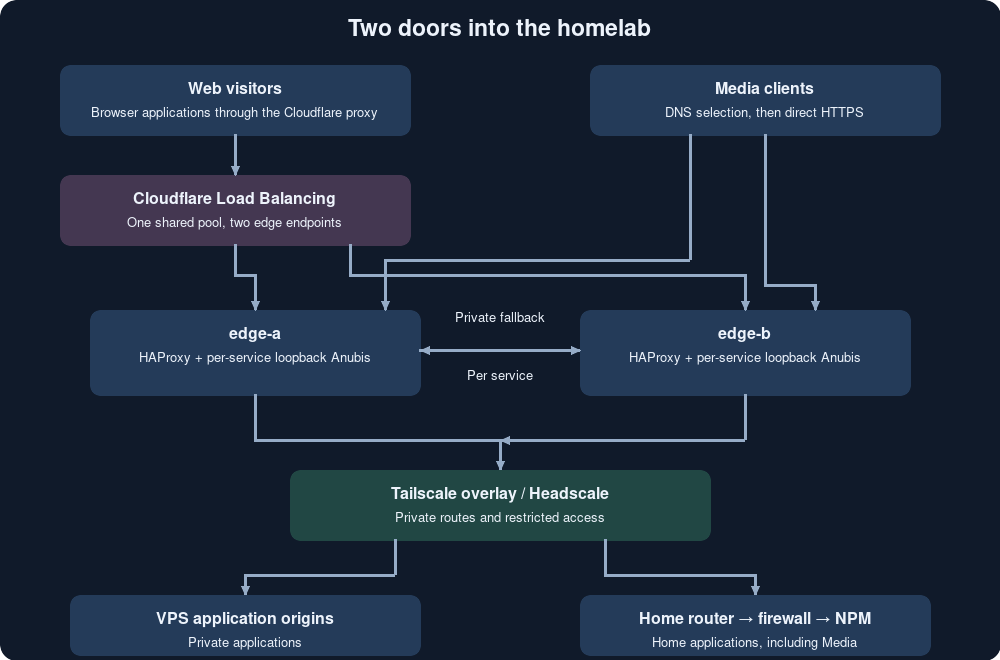
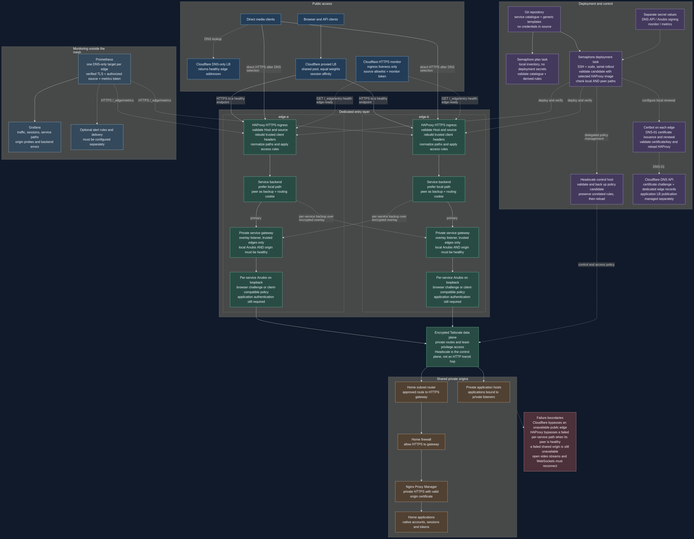
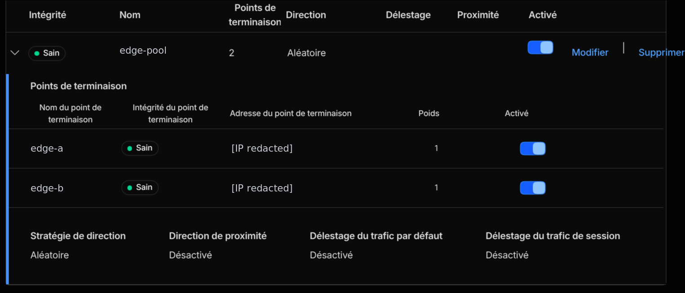
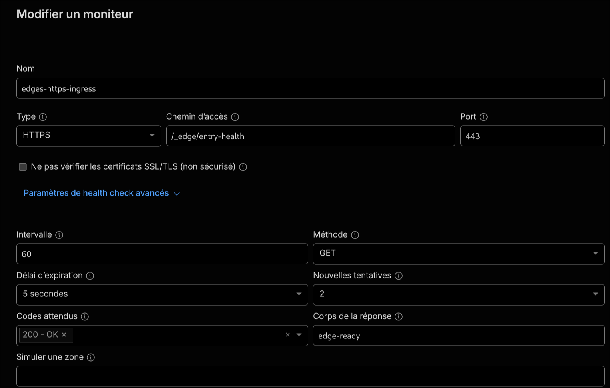
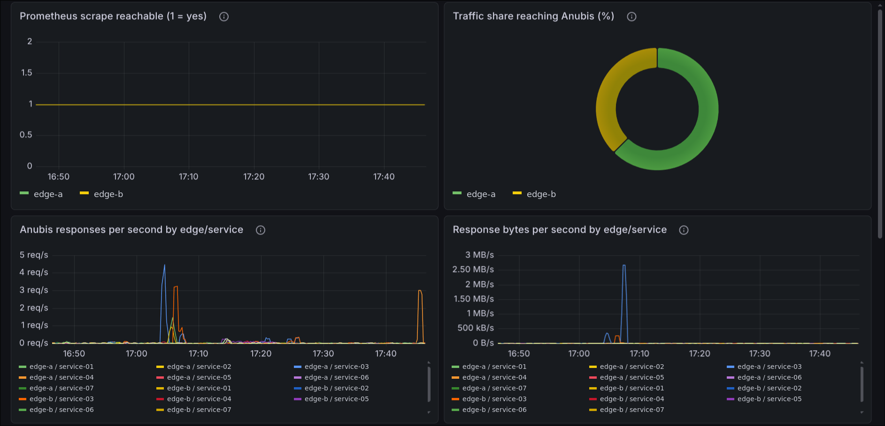
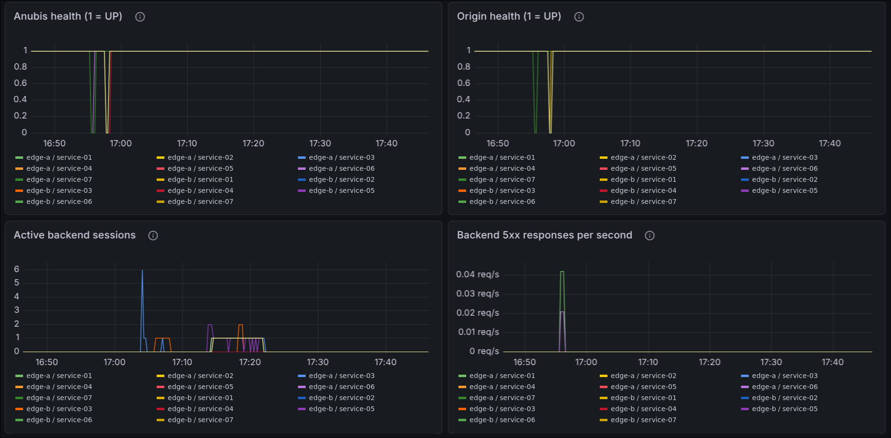
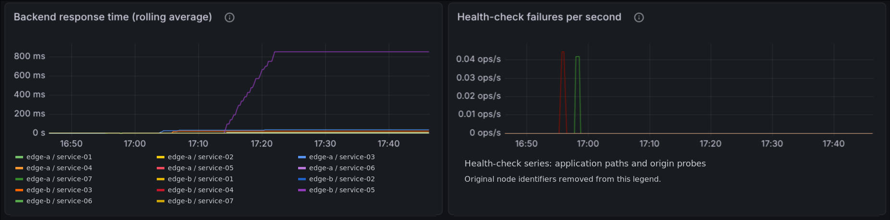

<h2>The homelab has two front doors now</h2>
<p>
In <a href="https://blog.interlope.xyz/my-homelab-setup-2">WIMH #2</a>, I described the VPS entry into the
lab: public traffic lands outside the house, then crosses the overlay to reach my services. The house keeps
its ports closed. That part stays.
</p>
<p>
What changed is the public entrance. The older setup mixed application hosting with Nginx and Anubis on the
same VPS machines. It worked, but moving the entrance onto a dedicated pair of machines gives me somewhere
else to send visitors when one edge fails.
</p>
<p>
So this is the writeup of that migration: two OVH VPS instances, HAProxy on both, an Anubis instance per
service on each, Cloudflare Load Balancing in front, and Semaphore deploying the configuration from Git. The media workload needed its own treatment, because a video client has very little interest in
solving a JavaScript challenge.
</p>
<p>
Grab a coffee. There are health checks inside health checks.
</p>
<blockquote><p>
Node names in this article are aliases. Public example addresses come from documentation ranges; private
addresses, internal DNS names and infrastructure identifiers are omitted or replaced. Screenshot labels have
been anonymized, with graph legends redrawn where needed; plotted values are unchanged. Configuration
fragments are shortened examples, not a dump of my access policy. No credentials, real client addresses, service hostnames or live service-to-host inventory are included. Application labels in screenshots are generic.
</p></blockquote>

<h2>What actually runs where</h2>
<p>
I'll call the public entry machines <code>edge-a</code> and <code>edge-b</code>. They live in different OVH
locations. The existing application VPS machines become <code>origin-a</code> and <code>origin-b</code>, while
the subnet router at home becomes <code>home-router</code>. Nginx Proxy Manager is still the HTTPS gateway to
the local applications.
</p>
<p>
Each edge runs HAProxy and an Anubis instance per configured application. Each Anubis has its own policy and target. The applications
themselves remain on their existing hosts.
</p>
<p>

</p>
<p>The following are illustrative routing patterns, not a catalogue of the live applications or their host assignments.</p>
<table>
<thead><tr><th>Example workload</th><th>Origin path</th><th>Public entrance</th></tr></thead>
<tbody>
<tr><td>Browser application</td><td>Private application host over the overlay</td><td>Cloudflare proxy</td></tr>
<tr><td>Application with native API clients</td><td>Private HTTPS gateway</td><td>Cloudflare proxy with application-specific challenge rules</td></tr>
<tr><td>Media workload</td><td>Private HTTPS gateway</td><td>DNS-only load balancing, direct HTTPS</td></tr>
</tbody></table>
<p>
For a service at home, the request travels through HAProxy, its selected Anubis, the Tailscale overlay, the
home subnet router, the firewall, and NPM before reaching the application. Between the router and NPM, the
firewall permits HTTPS to that gateway. The edges don't get a general invitation into the LAN.
</p>
<p>
Also, a change from that older WIMH post: this setup uses <strong>Headscale</strong> as its control plane. The
clients are still Tailscale clients. The article describing the official Tailscale control plane records an
earlier state of the lab.
</p>

<h3>The complete flow map</h3>
<p>This diagram separates visitor traffic from deployment, control and monitoring. Application groups are illustrative; no real service catalogue, hostnames or private addresses are included. Solid arrows show the main flow within each section, while dashed arrows identify secondary paths, checks or control operations.</p>
<figure>
<a href="../img/infrastructure-overview.png"></a>
<figcaption>Open the image at full size to follow the paths. Cloudflare checks the public entrance; each HAProxy checks its application paths. The shared origins remain a common dependency.</figcaption>
</figure>
<p>The <a href="../files/infrastructure-mermaid.txt">Mermaid source</a> describes this generic architecture. It is maintained documentation, not a production configuration export.</p>

<h3>Getting the private path ready first</h3>
<p>
The work started behind the public entrance. The edges needed a usable route to each origin before they could
proxy anything. Joining Headscale alone doesn't make a loopback-only application reachable, and a working
local curl doesn't prove that another node has permission to reach it.
</p>
<p>
One web application was a good example. Its existing port was bound to loopback for the old local reverse proxy. A second
binding on its overlay address let the new edges reach it while the old path stayed available during
migration. The other applications also needed their actual listening addresses checked. There was no reason to
open their application ports to the public Internet.
</p>
<p>
For the home services, the subnet router advertised the route to NPM. The edge clients accepted private routes
without using an exit node. Their ordinary Internet egress stayed their own, which also matters later for
Cloudflare API access.
</p>
<p>
The enrollment command looked like this, with the control hostname and node name replaced:
</p>


```bash
sudo tailscale up \
  --login-server=https://control.example.net \
  --hostname=edge-a \
  --advertise-tags=tag:edge \
  --accept-routes
```


<p>
The other edge uses its own hostname. Registration and approval happen through Headscale; an enrollment
command is not a substitute for checking the resulting tags, approved routes and connectivity.
</p>
<p>
I kept <code>tag:edge</code> as its own role. The access rules describe the application destinations and ports
the edges need, plus their private peer gateways. Giving these machines a broad management tag would have made
the initial tests easier and the trust boundary much worse.
</p>
<p>
One early timeout between the application VPS machines was consistent with that policy. The machines were
online, but their role didn't grant the origin access intended for the edges. The useful test was from a
correctly tagged edge, not from whichever machine happened to have a shell open.
</p>

<h2>Two different kinds of failover</h2>
<p>
This is the part that took the most explaining during the build. Cloudflare and HAProxy make different
decisions.
</p>
<p>
Cloudflare selects a public edge. Both edges are active, using equal endpoint weights and Random steering
inside one pool. With session affinity, this does not mean every other HTTP request lands on the other VPS. A
browser session can stay on one edge, and a long connection can account for much more traffic than a short
visit.
</p>
<p>
HAProxy then selects a path for the requested service. It prefers the local Anubis. If that local path is
unhealthy, it uses a private gateway on the other edge.
</p>


```text
Normal:
visitor → Cloudflare → edge-a → local Anubis → origin

Local Anubis unavailable:
visitor → Cloudflare → edge-a → private gateway on edge-b
                              → edge-b Anubis → origin

edge-a unavailable:
visitor → Cloudflare → edge-b → local Anubis → origin
```


<p>
The second path is per service. Losing one application's Anubis on edge-a does not send the other applications across
the mesh too. Their healthy local paths keep working.
</p>
<p>
The private gateways bind only to the edges' overlay addresses. Headscale controls access, and HAProxy
additionally checks the source edge and the expected Host. Crucially, a private gateway can reach only its own
local Anubis. It cannot send the request back to the peer. No proxy ping-pong.
</p>
<p>
HAProxy inserts a service-specific routing cookie to keep the chosen path consistent through challenges and
subsequent requests. Cloudflare's affinity cookie operates one level earlier, choosing the public edge. They
solve different problems.
</p>
<p>
None of this moves an already-open WebSocket or video connection between machines. A client has to reconnect.
There is also no extra HAProxy policy here to replay an application POST after receiving a response.
</p>

<h3>What the backend actually selects</h3>
<p>
Here is a shortened version of the generated backend on edge-a for an example application. The address tokens stand for
private overlay addresses and must be replaced before using this as configuration:
</p>


```haproxy
backend be_app
    cookie EDGE_ROUTE_app insert indirect nocache httponly secure
    option httpchk
    http-check send meth GET uri /_edge/health ver HTTP/1.1 hdr Host app.example.net
    http-check expect status 200

    server anubis EDGE_A_MESH_IP:18923 source EDGE_A_MESH_IP cookie edge-a check inter 5s fall 2 rise 2 init-state fully-down
    server peer EDGE_B_MESH_IP:18923 source EDGE_A_MESH_IP cookie edge-b backup check inter 5s fall 2 rise 2 init-state fully-down
```


<p>
The server named <code>anubis</code> here points to the local private gateway, which checks the complete local
path. The <code>peer</code> is a backup server. On edge-b, the generated configuration reverses the addresses
but keeps cookie values tied to the actual edge aliases.
</p>
<p>
<code>fall 2</code> and <code>rise 2</code> avoid changing state after one isolated probe result. They don't
promise a ten-second recovery for the whole chain: these gateway checks depend on the separate Anubis and
origin checks, their own intervals, and connection timeouts. The peer cannot be selected until HAProxy
considers it healthy.
</p>
<p>
A session that used the peer can remain there after the local route recovers because its routing cookie still
selects that path. A new session prefers the healthy local server. This is why looking at one browser
immediately after recovery isn't a reliable way to infer where all new traffic goes.
</p>

<h2>A green check has to mean something specific</h2>
<p>
A TCP port can be open while the application behind it is dead. Anubis can also return a perfectly good
challenge page while its target is unavailable. So checking for a generic HTTP 200 would tell a rather
optimistic story.
</p>
<p>
The configuration checks Anubis and the origin separately. A local service gateway is ready only when both are
healthy. With inter-edge redundancy enabled, the public readiness route accepts either a healthy local path or
a healthy peer path.
</p>
<table>
<thead><tr><th>Endpoint</th><th>Question it answers</th></tr></thead>
<tbody>
<tr><td><code>/_edge/entry-health</code></td><td>Can this edge receive HTTPS and respond through HAProxy?</td></tr>
<tr><td><code>/_edge/health</code> on an application Host</td><td>Does this service have a usable local or peer path?</td></tr>
<tr><td>Private gateway health</td><td>Are this edge's own Anubis and origin healthy?</td></tr>
<tr><td><code>/_edge/metrics</code></td><td>What states and traffic does HAProxy report?</td></tr>
</tbody></table>
<p>
The distinction matters because I ended up using one shared Cloudflare pool with two endpoints. Every public
load balancer reuses it. This kept the configuration within the endpoint allocation shown by my subscription,
rather than duplicating a two-endpoint pool for each service.
</p>
<p>
A shared pool also shares its health verdict. Using one application as its monitor would make its failure
influence all the other domains. Requiring every application to pass would let one failed common origin take
both edges out of rotation. Neither describes the health of the entrance very well.
</p>
<p>
The common monitor therefore checks HTTPS ingress only. HAProxy returns <code>edge-ready</code> on a dedicated
Host and path, after checking the network source and monitor token. The monitor expects a valid certificate,
HTTP 200 and that exact body.
</p>
<p>
It deliberately stays green when a shared application is down. The application checks and Prometheus show that
failure separately. <a href="https://developers.cloudflare.com/load-balancing/monitors/">Cloudflare's monitor
documentation</a> describes how those probes determine endpoint health.
</p>
<p>
There is a limit to this choice: an edge can keep answering the ingress probe while one service has lost both
its local route and its route through the peer. If the other edge can still serve that service directly, the
common monitor will not steer just that domain away from the broken edge. Separate service pools could make
that decision. This setup relies on the private per-service fallback for that layer.
</p>

<figure>

<figcaption>The shared pool after deployment: both endpoints healthy and enabled, with equal weights. Names and IP addresses have been replaced.</figcaption>
</figure>

<h3>The shared monitor, field by field</h3>
<p>
The monitor is HTTPS on port 443, using GET on <code>/_edge/entry-health</code>. Its configured interval is 60
seconds, timeout five seconds, with two retries. The expected result is HTTP 200 and <code>edge-ready</code>.
The option to skip certificate verification is unchecked.
</p>
<p>
These are monitor settings, not a measurement of how long a visitor waits during failure. Probe scheduling,
health decisions and existing connections all affect the result.
</p>
<figure>

<figcaption>The actual common monitor settings. Its request headers are configured separately; no token value is included in this screenshot.</figcaption>
</figure>

<h2>Anubis, without breaking the clients I actually use</h2>
<p>
<a href="https://github.com/TecharoHQ/anubis">Anubis</a> adds a browser proof-of-work challenge in front of an
application. It does not replace that application's login. In this deployment, its listeners and metrics stay
on loopback; HAProxy is the public HTTP entrance.
</p>
<p>
The policies follow the application. Browser-oriented services receive a challenge. The notification service's API and stream
routes bypass it so notifications and clients can work. The request application's API does too. The media service challenges its
root and web interface, while native API, media and socket routes continue to the application's
authentication.
</p>
<p>
An Anubis <code>ALLOW</code> rule means "skip this challenge". It does not mean "give this person access to my
libraries".
</p>
<p>
That distinction deserved a real check on the media service. Anonymous requests to the tested private routes, including
users, sessions, libraries, server configuration and API keys, returned 401 on both edges. The public
information route remained public, and the public user-list route returned an empty list. HAProxy blocked
<code>/health</code> and <code>/metrics</code> with 404, while the protected edge readiness route returned 403
without its secret.
</p>
<p>
Those results cover the routes tested, not every plugin or account permission in the media service. They do show why
"block the whole API" would have been the wrong fix: the clients need it.
</p>
<p>
The URL itself also needs attention before path-based restrictions. For the services with strict path rules,
HAProxy normalizes supported encodings and path components, and rejects ambiguous forms before applying
restrictions. Otherwise, protecting <code>/admin</code> while overlooking an equivalent encoded path is an
expensive way to learn about URL parsing.
</p>

<h3>A policy example: the browser route comes first</h3>
<p>
The media policy makes the exception explicit. This is the policy structure rendered by the template,
including the configured challenge difficulty:
</p>


```yaml
bots:
  - name: media-browser
    path_regex: '(?i)^/(?:web(?:/|$)|$)'
    action: CHALLENGE
    challenge:
      algorithm: fast
      difficulty: 5

  - name: media-native-routes
    path_regex: '^/'
    action: ALLOW
```


<p>
The web rule precedes the catch-all allowance, and its match is case-insensitive. The path restrictions in
HAProxy run before selecting the local or remote route, so choosing the peer cannot skip those restrictions.
</p>
<p>
The notification client needs a different list: message delivery, stream connections and client/application routes belong to
its normal API use. The request application needs its API routes for the web UI as well as integrations. Reusing the same
blanket browser policy everywhere would have been simpler YAML and broken clients.
</p>
<p>
The containers also have distinct targets and policy directories. A policy-content hash in their labels causes
a recreation when the policy changes. Mounting a directory rather than a single policy file avoids keeping an
old file inode mounted after an atomic replacement.
</p>

<h2>The media service gets the grey cloud</h2>
<p>
The other web services use proxied Cloudflare load balancers. The media service uses a DNS-only load balancer backed by
the same edge pool. Cloudflare participates in DNS selection and monitoring; the client connects directly to
an edge for HTTPS. The video traffic does not cross Cloudflare's reverse proxy.
</p>


```text
DNS:    media hostname → healthy edge address
HTTPS:  client → edge-a or edge-b → Anubis → home NPM → the media service
```


<p>
<a href="https://developers.cloudflare.com/reference-architecture/architectures/load-balancing/">Cloudflare
documents both proxied and DNS-only load balancing</a>. In the latter case, failover depends on detection and
DNS caching. An ongoing stream does not migrate, and a client can keep using a cached address for a while.
</p>
<p>
This needed a configuration change before the DNS switch. The proxied services accept public application
traffic from Cloudflare sources, plus explicit administrative exceptions. The media service needs to accept direct
clients on its own vhost. Turning the cloud grey without changing that restriction would have produced a very
well-protected 403 page.
</p>
<p>
I first tested from the administration connection, then from a phone outside that exception. The logs
confirmed direct client traffic on the second edge. Login and playback worked. That external test matters:
testing only through an allowlisted administration address can hide a broken public access rule.
</p>

<figure>

<figcaption>An application load balancer after migration, with its identifying labels replaced: one healthy pool with both endpoints. This row shows pool health, not application login behavior.</figcaption>
</figure>

<h2>One catalogue instead of seven copies of everything</h2>
<p>
Getting it running was half the job. Adding the eighth service shouldn't require remembering every place where
the first seven were listed.
</p>
<p>
The exposure configuration now lives in <code>docker/haproxy/vars/services.yml</code>. Each service declares a
permanent ID, domain, origin, policy profile and any special health or access rules. A shortened, anonymized
example:
</p>


```yaml
haproxy_service_catalog:
  example_app:
    id: 1
    domain: app.example.net
    origin: {node: origin-a, port: 8080}
    profile: browser
    admin:
      paths: [/admin]
    blocked_paths:
      - {path: /api, status: 403}
    dns: manual
```


<p>
The ID determines the local Anubis, metrics and private gateway ports. It stays stable when entries move
around in the YAML. Removing one service must not silently renumber every other listener.
</p>
<p>
The catalogue generates HAProxy routing, Anubis instances and policies, origin probes, private fallback paths,
and the required managed Headscale rules. A separate plan playbook validates the declarations without
contacting the VPS machines or changing DNS:
</p>


```bash
ansible-playbook -i localhost, docker/haproxy/plan_services.yml
```


<p>
That plan runs in a separate Semaphore template with a local inventory and no deployment secrets. It catches
declaration errors. It does not prove that an origin answers over the network.
</p>
<p>
Application deployment remains separate. The catalogue does not create a database, configure backups or
install a new service. First deploy the application privately and verify it. Then declare how the edges should
expose it.
</p>

<h3>The ports are derived, not counted by hand</h3>
<table>
<thead><tr><th>Listener</th><th>Formula</th><th>Example for ID 1</th><th>Exposure</th></tr></thead>
<tbody>
<tr><td>Anubis HTTP</td><td>8922 + ID</td><td>8923</td><td>Loopback only</td></tr>
<tr><td>Anubis metrics</td><td>9200 + ID</td><td>9201</td><td>Loopback only</td></tr>
<tr><td>Private edge gateway</td><td>18922 + ID</td><td>18923</td><td>Overlay address only</td></tr>
</tbody>
</table>
<p>
The compiler checks IDs, origins, supported profiles and derived listener collisions. An entry doesn't get to
refer to an arbitrary undefined origin. A disabled service leaves the active routing and Compose definition,
and managed permissions can be removed on the next deployment. Its data and public DNS are not automatically
deleted.
</p>
<p>
The plan writes a service summary and a Headscale ACL fragment on the runner. That gives me something concrete
to review before a deployment. It also keeps the maintenance path short: edit the catalogue, inspect the plan,
deploy to the edges, check the application, then publish the domain separately.
</p>
<h3>Adding an eighth service</h3>
<p>
For a new application behind home NPM, I first create its Proxy Host and confirm the internal application
works. NPM needs a valid certificate for the application hostname, and WebSocket support when the service uses
it. From the edge, testing with private resolution keeps TLS verification meaningful:
</p>


```bash
curl --noproxy '*' --connect-timeout 5 --max-time 15 \
  --resolve app.example.net:443:NPM_PRIVATE_IP \
  -I https://app.example.net/
```


<p>
Then comes a catalogue entry. This example is illustrative; it is not an eighth deployed service:
</p>


```yaml
  example_app:
    id: 8
    domain: app.example.net
    origin:
      node: npm
      port: 443
      scheme: https
    profile: browser
    health:
      path: /
      status: '200-399'
    dns: manual
```


<p>
For HTTPS origins, Anubis uses the application hostname while the deployment pins that name to the private
address. The HAProxy origin probe also sends the right SNI and verifies the certificate against that name.
Connecting privately is no excuse for adding <code>-k</code> and hoping for the best.
</p>
<p>
A service with clients that cannot solve a browser challenge may need <code>profile: native</code> and an
explicit health route returning 200. That choice leaves authentication with the application. A new policy
behavior outside the existing profiles is a code change, not something the catalogue can guess.
</p>

<h2>What Semaphore actually does</h2>
<p>
Semaphore runs <code>docker/haproxy/deploy_haproxy.yml</code> from the repository, with the inventory, SSH
credentials, privilege-escalation settings and secret variable group. The pair deploys serially, one edge at a
time.
</p>
<p>
The playbook checks the target and mesh membership, verifies routes and origin responses, obtains the
certificate, pulls the selected images, and validates the candidate HAProxy configuration with the downloaded
image before installing it. After deployment it checks TLS, challenges, aliases, restrictions and readiness.
With peer readiness required, a healthy fallback cannot hide a broken local path: both receive their own
checks.
</p>
<p>
The images intentionally use <code>haproxy:lts</code> and Anubis <code>latest</code>. A deployment can
therefore bring an image update as well as a configuration change. That's part of how this lab is operated,
not a claim that a moving tag is reproducible.
</p>
<p>
Four secrets have separate jobs:
</p>
<ul>
<li>The Cloudflare DNS API token is used for DNS-01 certificate validation and the dedicated edge DNS records.</li>
<li>The Anubis signing key is shared by the instances on both edges.</li>
<li>The monitor token authorizes external health probes.</li>
<li>The metrics token authorizes Prometheus collection.</li>
</ul>
<p>
They are stored as secret extra variables in Semaphore. The playbook also supports environment fallbacks, but
there is no reason to define competing copies in both places.
</p>
<p>
Headscale management runs through delegated Ansible tasks on the control host. It reads the active policy,
updates the rules owned by this deployment, validates a candidate with Headscale, backs up the previous file
and reloads the policy. An adjacent tracking file records which rules it owns so obsolete permissions can be
removed. The rest of the policy stays intact.
</p>
<p>
Cloudflare application load balancers remain configured separately. The playbook manages dedicated DNS-only
edge names, and has an optional single-primary DNS publication mode. That mode points at one edge; it is not
the two-edge load balancer. The migrated services keep manual application publication in the catalogue.
</p>

<h3>Bootstrap, then require the peer</h3>
<p>
The first edge cannot pass a peer check against a machine that hasn't been deployed yet. Bootstrap therefore
happens with peer readiness not required. Once both stacks run, I enable the blocking peer validation and
deploy again:
</p>


```yaml
haproxy_edge_redundancy_enabled: true
haproxy_edge_require_peer_ready: true
```


<p>
That second setting stays enabled for normal operation. It makes an incomplete peer configuration fail the
deployment instead of quietly shipping a broken fallback. A maintenance window on the peer can make this
validation fail even while the running local path continues serving users; deployment success and current
local availability are different questions.
</p>
<p>
The deployment template targets the edge inventory group. A typical ordinary extra-variable selection, with
aliases substituted, is:
</p>


```json
{"target_hosts": "vps_haproxy"}
```


<p>
The SSH account must work on each edge and on the host receiving delegated Headscale tasks. Collections also
have to be available to the runner. In the successful deployment, Galaxy installation is skipped because the
execution environment already has its required collections. Skipping that step does not install missing
modules.
</p>
<h3>A successful run, with the retries left in</h3>
<p>
The migration deployment completed on both edges with no unreachable hosts and no failed tasks. I retain the full job output privately; this article describes the checks without publishing its application inventory.
</p>
<p>
Before completing the run, both edges retried the per-domain HTTPS check once. The eventual checks passed. A
retry message in the middle of this log is therefore not a failed final deployment, but it is still useful
information about startup convergence.
</p>
<p>
The run checked every configured service's public TLS route on the selected node, its browser-policy behavior
where applicable, the four blog-alias redirects, and service readiness. It then checked the local paths
separately and required every configured peer path. That last distinction prevents a working peer from masking a
broken local installation during rollout.
</p>
<p>
The access tests included the blog API and administration paths, an encoded-path case, the media service health and
metrics restrictions, and the metrics route. They verify the specific expected responses in the playbook; they
aren't a full application penetration test.
</p>
<p>
The Headscale candidate was validated during this run. Reloading was skipped because the active policy did not
change. Temporary candidate files also count as changes in the job. A change counter is not a count of application settings altered.
</p>
<p>
The application publication task was skipped, and the final message explicitly left the Cloudflare pools and
affinity unchanged. Semaphore also reported successful delivery of its deployment notification. That is useful
deployment feedback, alongside the separate functional notification tests.
</p>


<h2>The bits that complained during deployment</h2>
<p>
The first edge did not materialize from one flawless green Semaphore run. There were runner dependency and
proxy issues, then SSH user and sudo settings to align with the working templates. Having a valid SSH key is
only useful if the template chooses the account that can use it.
</p>
<p>
Certificate issuance then failed because the Cloudflare token restricted the allowed source addresses. Certbot
runs on the edge, so Cloudflare saw the edge's public egress, not the Semaphore runner. The token needed to
authorize each issuing edge for renewals too.
</p>
<p>
Certificates are obtained locally through DNS-01. The renewal hook assembles the certificate and private key,
checks that they match, validates HAProxy and signals its master to reload. If validation or signalling fails,
it restores the previous PEM on disk. That is a local safeguard, not a full transactional rollback of a
deployment.
</p>
<p>
Later, both Cloudflare endpoints showed a TLS name mismatch even though the local HTTPS probe worked. The fix
was in the monitor headers:
</p>


```text
Host: edge-health.example.net
X-Edge-Health-Token: <monitor secret>
```


<p>
Those are two headers. The technical hostname is the value of <code>Host</code>; it is not a header name. The
monitor uses that Host for TLS SNI. Endpoint Host overrides stay empty so they don't replace the intended
name. Certificate verification stayed enabled. <a
href="https://developers.cloudflare.com/load-balancing/troubleshooting/common-error-codes/">Cloudflare's error
reference</a> covers this mismatch.
</p>

<h2>Trust the connection before trusting its headers</h2>
<p>
For proxied requests, HAProxy accepts the visitor address in <code>CF-Connecting-IP</code> only when the
actual connection comes from a configured Cloudflare range. Otherwise, the connection source is the client
address. It rebuilds forwarding headers before passing traffic downstream.
</p>
<p>
Without that boundary, anyone able to reach the listener could claim to be the administration address by
supplying a header. Source filters for metrics and monitors use the real network peer, not the reconstructed
visitor address.
</p>
<p>
The Cloudflare ranges are an explicit snapshot in configuration. They need review when Cloudflare changes
them. Anubis stays on loopback, private gateways stay on the overlay, and the unauthenticated local Prometheus
exporter stays on loopback too.
</p>
<p>
HAProxy logs connection and backend information without logging request URLs. The notification service and the media service can carry
credentials in query strings; those URLs do not belong in a log excerpt pasted into a blog post.
</p>

<h2>Yes, there are graphs</h2>
<p>
The existing Prometheus stack collects HAProxy metrics over public HTTPS using dedicated DNS-only names for
each edge. The monitoring host doesn't need to join the mesh. The metrics route requires both an authorized
source address and its own Bearer token.
</p>
<p>
Grafana can then show traffic, sessions, backend errors and health by edge and service. Local Anubis and
origin states remain separate, with the peer path alongside them. A green peer path can keep the application
reachable while a local component needs repair.
</p>
<p>
Traffic share needs some restraint when interpreting it. HAProxy sees requests that reach the edges, not
requests already satisfied by Cloudflare's cache. A video stream and a blog visit aren't comparable units of
work. Equal endpoint weights won't make those graphs perfectly symmetrical.
</p>
<p>
Likewise, HAProxy metrics don't contain Cloudflare's actual pool verdict. That belongs to Cloudflare's monitor
and event view. And a dashboard import doesn't install Prometheus alert rules or configure notification
delivery. The reference rules still need to be loaded and connected to the existing alerting setup.
</p>

<h3>The scrape configuration</h3>
<p>
Each target has a dedicated DNS-only name. If I used an application load-balancer name here, I could scrape
whichever edge got selected twice and believe I was observing both. The labels and targets below are
anonymized, and the proxy address stands in for the monitoring stack's existing outbound proxy:
</p>


```yaml
scrape_configs:
  - job_name: haproxy-edges
    scrape_interval: 15s
    scrape_timeout: 10s
    scheme: https
    proxy_url: http://monitor-proxy.example.net:3128
    metrics_path: /_edge/metrics
    authorization:
      type: Bearer
      credentials_file: /etc/prometheus/secrets/edge-metrics-token
    tls_config:
      insecure_skip_verify: false
    static_configs:
      - targets: ['edge-a.example.net:443']
        labels:
          edge: a
      - targets: ['edge-b.example.net:443']
        labels:
          edge: b
```


<p>
The secret file must be mounted and readable inside Prometheus. The source restriction on HAProxy needs to
match the actual public egress of that scrape path. A correct token coming from another source is still
refused.
</p>
<p>
The basic reachability query is <code>up{job="haproxy-edges"}</code>. A value of one means the scrape
succeeded. It does not mean every application is up, nor that Cloudflare agrees with HAProxy about an
endpoint's state.
</p>
<figure>

<figcaption>A real observation window after migration. Both scrape series are at one; traffic reaching Anubis is uneven across the two edges. Legend labels have been anonymized.</figcaption>
</figure>

<p>
The traffic screenshot shows a larger slice for one edge and a short burst of media response bytes. It is a
snapshot of requests and bytes reaching this layer, not a benchmark or a unique-user count. Equal configured
weights do not make an uneven short window evidence of a routing fault.
</p>
<figure>

<figcaption>The sampled health window contains brief drops and a few backend errors, followed by healthy values. The screenshot alone does not identify their cause.</figcaption>
</figure>

<p>
There is a naming trap in this dashboard version: the panel titled "Anubis health" displays <code>be_*</code>
series. With redundancy enabled, those backends represent service paths through the private gateways. I read
them alongside the <code>probe_*</code> origin series, rather than treating that title as proof of an isolated
Anubis process state.
</p>
<p>
The short health drops and error peaks are visible around the same part of the window. To assign a cause, I
would need the corresponding logs and a time-aligned deployment or incident event. These captures don't
establish an end-user outage duration.
</p>
<figure>

<figcaption>Rolling response time and check failures. The health-check legend containing infrastructure labels has been removed; the plotted samples are unchanged.</figcaption>
</figure>

<p>
One rolling response-time series rises to roughly 850 ms and then stays flat in this window. That's a reason
to inspect the underlying samples and request volume, not enough information to announce a regression or a
percentile. The panel is a rolling average; it doesn't show a p95 latency, and a quiet service can retain a
value without generating much new traffic.
</p>

<h2>The migration, with things deliberately stopped</h2>
<p>
I deployed and tested the edges before changing the public application names. Local resolution overrides let
the browser use the real hostname and certificate while contacting the new machine. The public DNS still
served the older entrance during those tests.
</p>
<p>
The checks went beyond seeing a challenge page: application logins, live updates, notifications and the media service
playback all needed their own tests. Both edges also passed the deployment's local and peer
readiness checks with peer validation required.
</p>
<p>
For the private fallback test, one application's Anubis on edge-a was stopped. Requests entering edge-a used the
peer path, and a WebSocket opened through edge-b. The application origin stayed running. That tested the
fallback layer without deliberately taking the shared application down.
</p>
<p>
The public migration started with one status service. After its load balancer was active, HAProxy on edge-a
was stopped. Cloudflare detected the failed entrance, the other edge served the status application, and edge-a
was restored. This was an actual stop-and-recover test; it wasn't just two green endpoints sitting next to
each other.
</p>
<p>
The remaining proxied services followed, with logins and notifications checked after migration. The root
domain and <code>www</code> were pointed at the blog and their redirects checked. The media service moved separately to
DNS-only load balancing, followed by direct access and playback tests from the phone.
</p>
<p>
Finally, the old application vhosts were disabled and the redundant old Anubis containers stopped. The
application containers stayed running: the new edges still use them. Nginx and Certbot also stayed where other
active services needed them, including the Headscale entrance. Disabling those old vhosts means rollback now
requires restoring them as well as changing the public routing.
</p>

<h3>The commands behind the checks</h3>
<p>
A direct test can target the new edge without changing public DNS. This example address is a documentation
address, not one of my VPS addresses:
</p>


```bash
curl --noproxy '*' --silent --show-error \
  --connect-timeout 5 --max-time 15 \
  --resolve app.example.net:443:192.0.2.10 \
  --output /dev/null \
  --write-out 'HTTP %{http_code}, TLS %{ssl_verify_result}\n' \
  https://app.example.net/
```


<p>
The hostname stays in the URL so Host and SNI remain correct. A TLS verification result of zero and a valid
response establish the connection, but HTTP 200 may still be an Anubis challenge. The next step is opening the
application and using it.
</p>
<p>
On the edge itself, the common monitor can be checked over loopback with certificate verification intact:
</p>


```bash
curl --noproxy '*' --silent --show-error --max-time 10 \
  --resolve edge-health.example.net:443:127.0.0.1 \
  https://edge-health.example.net/_edge/entry-health
```


<p>
The expected body is <code>edge-ready</code>. Loopback is exempt from the external monitor token requirement.
That local result cannot prove Cloudflare's external probe source, headers or firewall access are correct.
</p>
<p>
The two controlled stop tests exercise different layers:
</p>
<table>
<thead><tr><th>Stopped component</th><th>Expected routing</th><th>Evidence used</th></tr></thead>
<tbody>
<tr><td>One service's local Anubis</td><td>That service enters the same edge, then uses the peer</td><td>Peer backend selection and a working application/WebSocket</td></tr>
<tr><td>One edge's HAProxy</td><td>Cloudflare marks that entrance unavailable and selects the other</td><td>Cloudflare state, surviving edge logs and browser access</td></tr>
</tbody>
</table>
<p>
For the first case, the relevant container name has the shape <code>haproxy-prod-anubis-example_app</code>. For
the second, it is <code>haproxy-prod</code>. The restoration is starting that same container again and waiting
for health checks to settle. These were controlled tests during migration, not commands to run casually
against both entrances at once.
</p>
<p>
I also kept the public readiness and metrics routes in the negative tests: an unauthenticated request from the
workstation received 403. A monitoring route that returns the expected data only to its authorized caller is
behaving differently from one that happens to answer everyone.
</p>
<h3>Cleaning up without deleting the origins</h3>
<p>
The old application CNAME records were retained while the same-name Cloudflare load balancers took over public
routing. That made the DNS side of rollback simpler during migration. It did not preserve the old application
entrance after its Nginx vhost was disabled.
</p>
<p>
The cleanup therefore happened in stages: disable migrated application vhosts, validate and reload Nginx,
check the retained services, then stop the old Anubis containers. The origin applications, the control-plane
entrance and other still-used vhosts remained in place. Certificates weren't removed just because one
application name had migrated.
</p>
<p>
This is also why the old Nginx deployment playbook isn't part of the new edge procedure. Rerunning it during
cleanup could recreate the entrance I had just retired. The two playbooks belong to different architectures.
</p>

<h2>What two edges do not fix</h2>
<p>
Both entrances use the same application origins. If a single application instance fails, neither edge can
manufacture a replacement application. If the home connection, home gateway or NPM fails, the home-hosted services can lose
both paths at once.
</p>
<p>
The pair also remains with one VPS provider, and Cloudflare is still a dependency for the proxied services.
Different locations reduce some shared failure risks; they don't remove every one.
</p>
<p>
What is deployed now is a redundant public entrance, with per-service private fallback and a catalogue that
makes the next addition less tedious. Application availability still depends on each application's own
storage, backups and redundancy.
</p>
<p>
Seven services migrated, two entrances answering, and a stopped edge no longer being the end of the story.
That's a useful place to leave this round of homelab-ing.
</p>
<p>
Thanks for reading me,
</p>
<p>
spleenftw
</p>
